# 我的記帳本

家庭與個人一起用的記帳 App。夫妻、家人各自記帳，家裡的錢和自己的錢分得清清楚楚，打開就知道現在真正能花的有多少、接下來兩個月的錢夠不夠用。

這是 [我的記帳本網頁版](https://github.com/onion523/my-money) 的 iOS App，和網頁版共用同一個帳號與資料，支援 iPhone 與 iPad。

<table>
  <tr>
    <td align="center">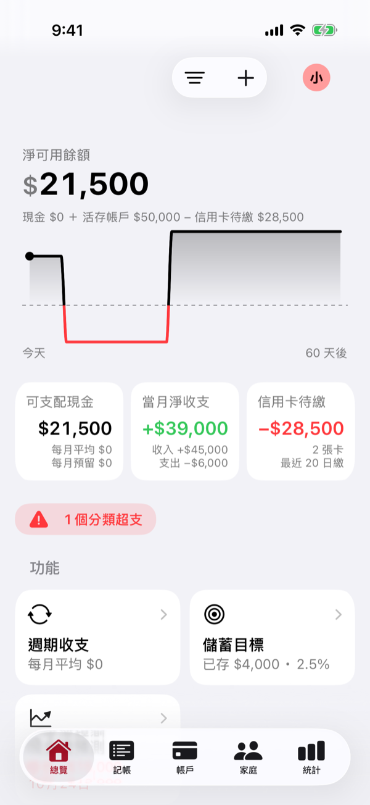 總覽</td>
    <td align="center">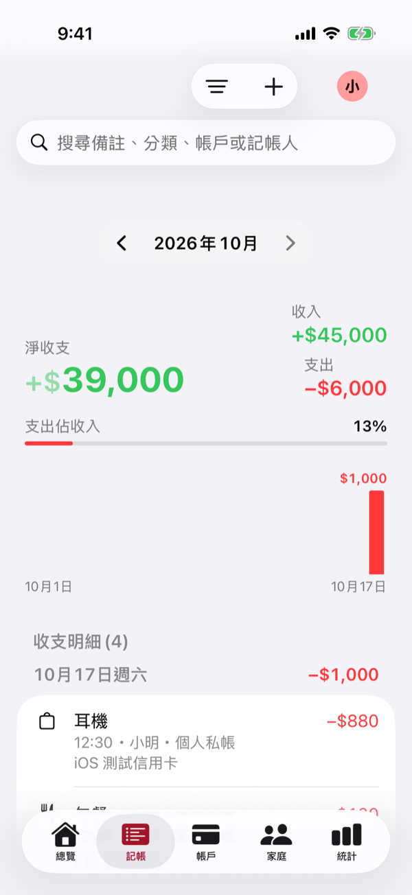 收支明細</td>
    <td align="center">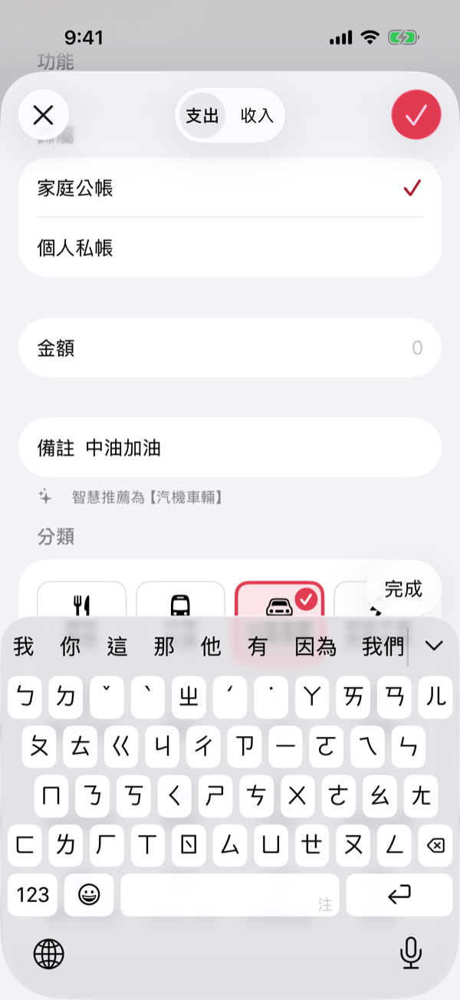 記一筆，分類自動推薦</td>
    <td align="center">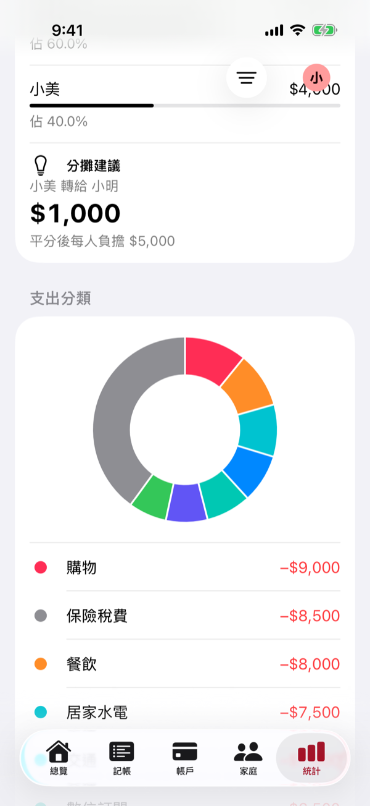 統計與分攤建議</td>
  </tr>
</table>

## 功能特色

### 🏠 家裡的錢、自己的錢分開看

- 每一筆記帳都標成「家庭公帳」或「個人私帳」
- 總覽、統計與預測都能切換成全部、只看家庭公帳或只看個人私帳
- 家人記的帳也看得到，誰記的、記在哪個帳戶一目了然
- 用自己的錢替家裡代墊的支出會記下來，之後由家庭撥款報銷

### 💰 一眼看懂現在能花多少

- **淨可用餘額**：現金加活存帳戶，扣掉信用卡待繳款
- **真實可支配現金**：再扣掉年繳、季繳費用攤到每個月的金額，以及每月要存的錢
- **當月淨收支**與**信用卡待繳**，哪個分類超出預算也會提醒
- 首頁直接列出接下來 60 天的預定收支，繳完一筆勾一筆

### ✍️ 記帳又快又準

- 記一筆只要選帳戶、輸入金額，分類會依照你過去的習慣和備註內容自動推薦
- 收支明細可以按月份快速切換，依帳戶、分類、類型篩選，也能搜尋備註
- 每天的支出長條圖和「支出佔收入」比例，馬上看出哪天花最多
- 收支明細可以匯出成 CSV

<table>
  <tr>
    <td align="center">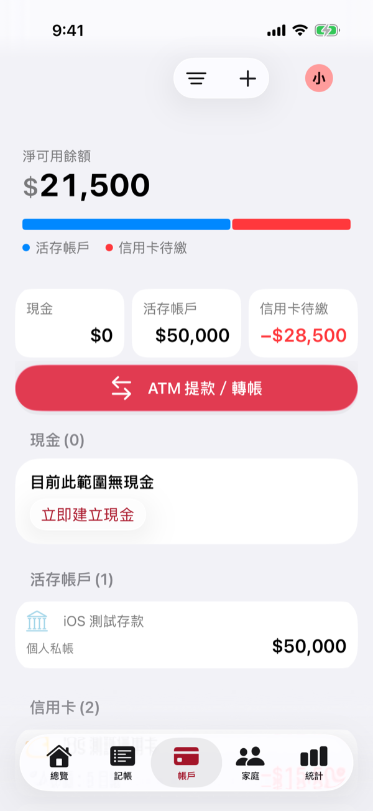 帳戶</td>
    <td align="center">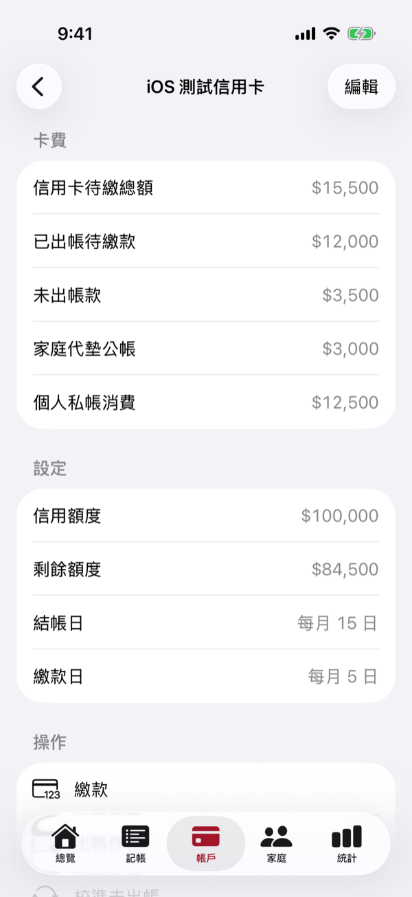 信用卡</td>
    <td align="center">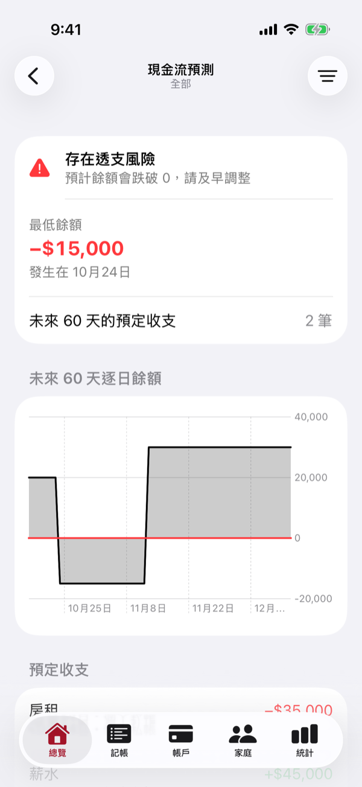 現金流預測</td>
  </tr>
</table>

<table>
  <tr>
    <td align="center">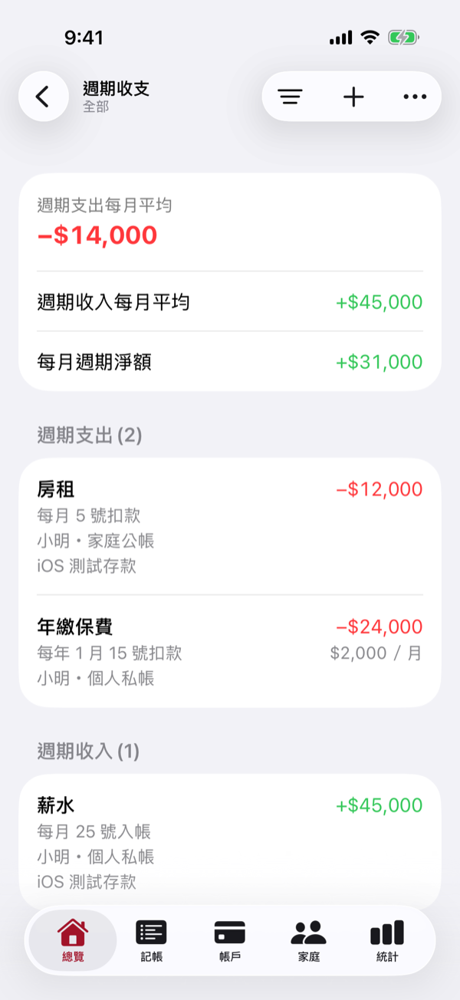 週期收支</td>
    <td align="center">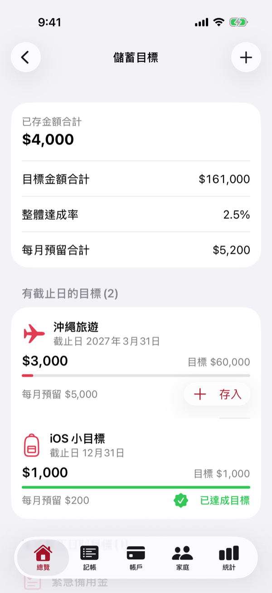 儲蓄目標</td>
    <td align="center">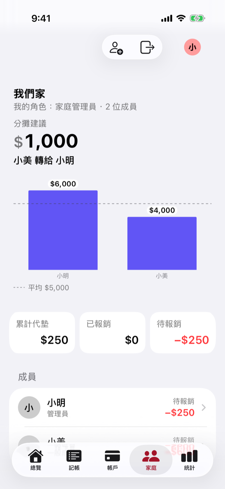 家庭</td>
  </tr>
</table>

### 💳 現金、活存與信用卡

- 現金、活存帳戶與信用卡分開管理，ATM 提款與帳戶間轉帳也能記
- 信用卡會記住結帳日與繳款日，分開顯示已出帳與未出帳的金額
- 結帳日可以先預覽這期要出帳的消費，逐筆決定要不要延到下一期
- 繳卡費可以只繳家庭代墊的部分、只繳個人的部分，或全額結清

### 📅 週期收支與儲蓄目標

- 房租、保費、訂閱這類固定收支設定一次，月繳、季繳、年繳都會換算成每月平均
- 設定儲蓄目標與截止日，隨時存入、看達成率

### 📊 統計、預算與現金流預測

- 每個月的支出分類圓餅圖與全年收支趨勢
- 為各分類設定預算，超支馬上知道
- **現金流預測**：推算未來 60 天每天的餘額，提早看出哪一天可能不夠用，大筆消費前也能先試算，看會不會影響儲蓄目標

### 👨‍👩‍👧 家庭

- 建立家庭並邀請家人加入，家庭管理員與一般成員權限不同
- 家庭公帳的收支、帳戶與週期收支大家一起看

### 🤖 用聊天機器人記帳

綁定 LINE 或 Telegram 機器人，傳一句話就能記一筆。

### 🌙 舒服好讀

- 深色模式、系統文字大小與 VoiceOver 都完整支援
- iPad 有專屬的側邊欄版面

<table>
  <tr>
    <td align="center">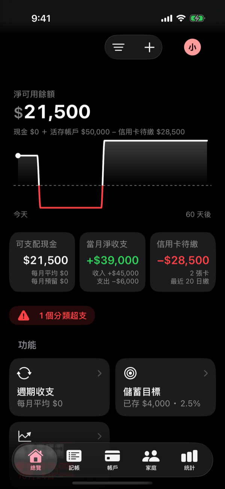</td>
    <td align="center">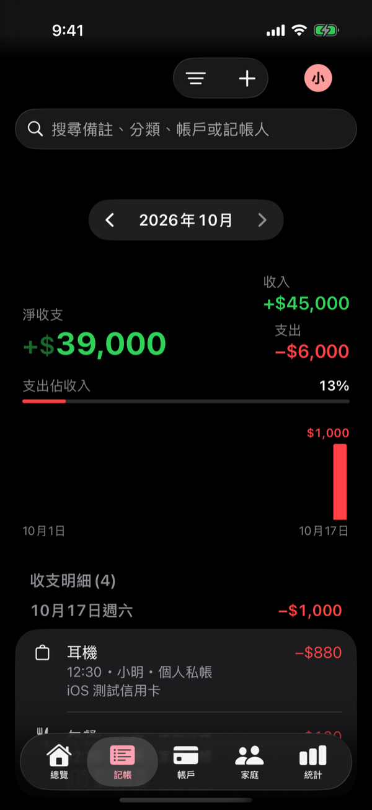</td>
    <td align="center">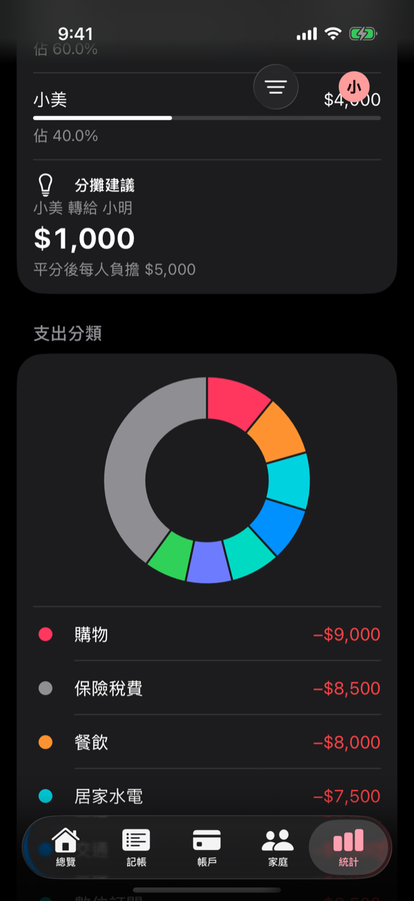</td>
    <td align="center">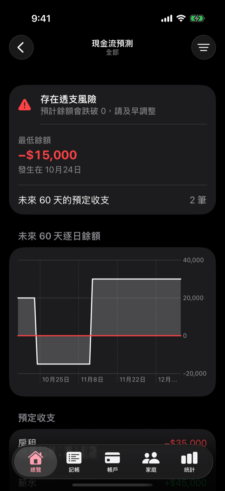</td>
  </tr>
</table>

> 截圖使用範例資料。

## 開發者

開發流程、架構與規則請看 [CLAUDE.md](CLAUDE.md)；和網頁版的功能對照見 [docs/parity.md](docs/parity.md)。
